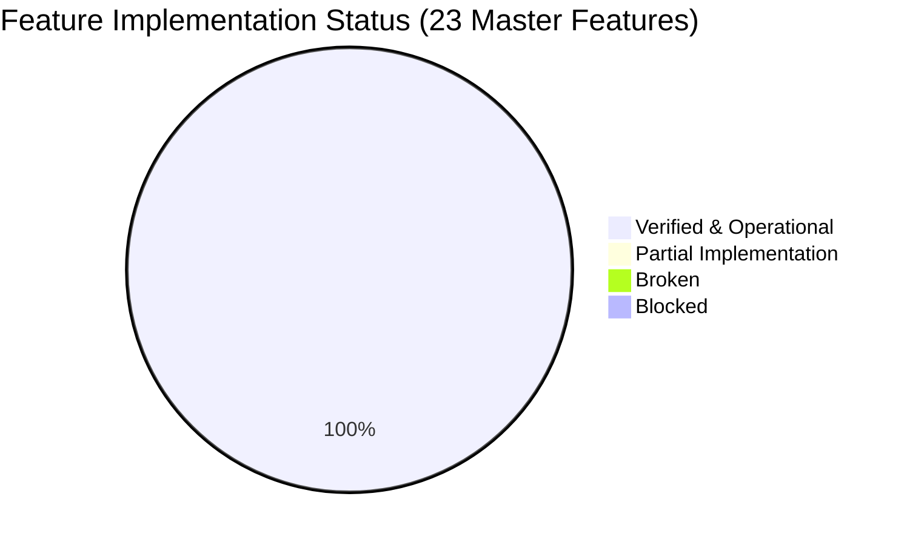
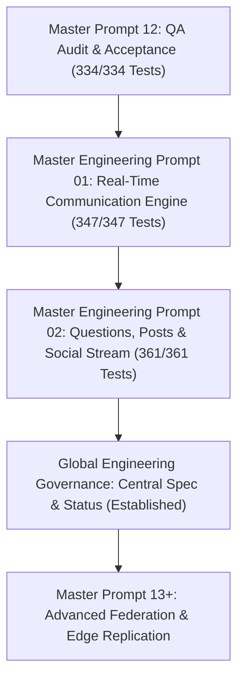

# Soulverse Implementation Status & Governance Ledger

**Document Version**: 1.2.0  
**Last Updated**: 2026-11-15T00:02:00+05:30  
**Platform Operational State**: **PRODUCTION READY (ALL 23 MASTER FEATURES VERIFIED)**

---

## 1. Executive Status Dashboard

### Key Health & Readiness Indicators
- **Overall Completion Rate**: **100% (23 / 23 Master Features Verified)**
- **Total Automated Test Suites**: **23 Test Files**
- **Total Passing Tests**: **361 / 361 Tests (100% Green)**
  - Core Backend Test Suites: 22 files / 345 tests
  - Dedicated Admin Backend Suite: 1 file / 16 tests
- **Static Analysis & Builds**:
  - `frontend`: 0 TypeScript errors (2,197 modules transformed)
  - `admin-frontend`: 0 TypeScript errors (2,104 modules transformed)
- **Live Infrastructure Services**:
  - Core API Gateway (`http://localhost:3001`): **HEALTHY** (`better-sqlite3`, WAL mode, integrity OK)
  - User Application Experience (`http://localhost:5173`): **ONLINE** (`200 OK`)
  - Admin Operations Sanctuary (`http://localhost:5174`): **ONLINE** (`200 OK`)

---

## 2. Granular Feature Implementation Ledger

| Feature ID | Feature Name | Domain | Status | Tests Passed | Last Verified | Primary Components & Routes |
| :--- | :--- | :--- | :---: | :---: | :---: | :--- |
| **IDENTITY-001** | Multi-Space Authenticated Personas | Identity & Profile | **VERIFIED** | 12 | 2026-11-14 | `IdentityUniverseHub.tsx`, `MyCharacterBuilder.tsx`, `/api/v1/profile/identities` |
| **IDENTITY-002** | Custom Sections & Markdown | Identity & Profile | **VERIFIED** | 8 | 2026-11-14 | `GitHubMarkdownEditor.tsx`, `LivingIdentityProfileView.tsx`, `/api/v1/profile/sections` |
| **IDENTITY-003** | Chronological Life Timeline | Identity & Profile | **VERIFIED** | 6 | 2026-11-14 | `YearLifeTimelineView.tsx`, `Timeline.tsx`, `/api/v1/profile/timeline` |
| **PSYCHOLOGY-001**| Big Five (OCEAN) Framework | Psychology & EI | **VERIFIED** | 6 | 2026-11-14 | `PersonalitySanctuaryView.tsx`, `/api/v1/personality/:userId` |
| **PSYCHOLOGY-002**| EQ & Attachment Profiling | Psychology & EI | **VERIFIED** | 6 | 2026-11-14 | `PersonalitySanctuaryView.tsx`, `/api/v1/personality/eq/:userId` |
| **DISCOVERY-001** | Multimodal Compatibility Cards | Discovery & Dating | **VERIFIED** | 14 | 2026-11-14 | `SoulverseMobileDiscoverExperience.tsx`, `SocialDiscoveryEngineView.tsx`, `/api/v1/discovery/feed` |
| **MATCHING-001** | Connection Request Lifecycle | Discovery & Dating | **VERIFIED** | 8 | 2026-11-14 | `SoulverseConnectionsPage.tsx`, `LikesAndMatchesView.tsx`, `/api/v1/connection-requests` |
| **RELATIONSHIP-001**| Non-Linear Relationship Vault | Relationship Management | **VERIFIED** | 12 | 2026-11-14 | `RelationshipVaultDashboard.tsx`, `IndividualRelationshipDetailModal.tsx`, `/api/v1/vault/persons` |
| **MEMORY-001** | Interpersonal Context Vault | Relationship Management | **VERIFIED** | 6 | 2026-11-14 | `BeforeYouTalkSheet.tsx`, `QuickConversationMemoryModal.tsx`, `/api/v1/vault/memories` |
| **CONTENT-001** | Infinite Wisdom Quotes | Connection Content | **VERIFIED** | 24 | 2026-11-14 | `QuoteDiscoveryView.tsx`, `/api/quotes/discover`, `/api/quotes/categories` |
| **CONTENT-002** | Daily Soul Prompts & Sanctuary | Connection Content | **VERIFIED** | 9 | 2026-11-14 | `SoulJournalSanctuary.tsx`, `/api/soul-prompts/today`, `/api/soul-prompts/responses` |
| **QUESTION-001** | Multidimensional Question Discovery | Connection Content | **VERIFIED** | 5 | 2026-11-15 | `QuestionSanctuaryView.tsx`, `offlineContentDb.ts`, `/api/v1/social/questions` |
| **QUESTION-002** | Question Answering & ABAC Privacy | Connection Content | **VERIFIED** | 4 | 2026-11-15 | `QuestionSanctuaryView.tsx`, `/api/v1/social/questions/:id/answers` |
| **FEED-001** | Multimodal Post & Publishing Engine | Social Feed & Pub | **VERIFIED** | 5 | 2026-11-15 | `PostComposerModal.tsx`, `offlineContentDb.ts`, `/api/v1/social/posts` |
| **FEED-002** | Transparent Social Feed & Reactions | Social Feed & Pub | **VERIFIED** | 5 | 2026-11-15 | `SocialFeedView.tsx`, `/api/v1/social/posts`, `/api/v1/social/comments` |
| **AI-001** | Bring Your Own AI (BYOAI) | Personal AI Engine | **VERIFIED** | 22 | 2026-11-14 | `byoaiService.ts`, `AIRelationshipAssistantModal.tsx`, `/api/ai/connections` |
| **AI-002** | Task Routing & Spending Caps | Personal AI Engine | **VERIFIED** | 8 | 2026-11-14 | `byoaiService.ts`, `UserControlCenterModal.tsx`, `/api/ai/dispatch`, `/api/ai/usage` |
| **MESSAGING-001** | Monotonic Sequenced Messaging | Real-Time Comms | **VERIFIED** | 24 | 2026-11-14 | `MessagingInboxView.tsx`, `ChatInterface.tsx`, `/api/v1/conversations/:id/messages` |
| **MESSAGING-002** | Reactions, Emojis & Games | Real-Time Comms | **VERIFIED** | 15 | 2026-11-14 | `CouplePlayHubView.tsx`, `MessagingInboxView.tsx`, `/api/telegram-emojis/style` |
| **MESSAGING-003** | Local-First Offline Outbox & Sync | Real-Time Comms | **VERIFIED** | 5 | 2026-11-14 | `offlineChatDb.ts`, `chatApiClient.ts`, `/api/v1/conversations/:id/sync` |
| **CALLING-001** | WebRTC Real-Time Calling | Real-Time Comms | **VERIFIED** | 4 | 2026-11-14 | `webrtcCallService.ts`, `MessagingInboxView.tsx`, `/api/v1/calls` |
| **POLLS-001** | Real-Time Polls & Consensus Voting| Real-Time Comms | **VERIFIED** | 4 | 2026-11-14 | `MessagingInboxView.tsx`, `/api/v1/conversations/:id/poll`, `/api/v1/messages/:id/poll/vote` |
| **ADMIN-001** | Air-Gapped Admin Console | Admin Governance | **VERIFIED** | 27 | 2026-11-14 | `admin-frontend/src/App.tsx`, `AdminDashboard.tsx`, `/api/features/registry` |
| **SECURITY-001** | GDPR Compliance (Arts 17/20) | Privacy & Security | **VERIFIED** | 12 | 2026-11-14 | `SoulverseAccountPage.tsx`, `/api/v1/users/:userId/export`, `/api/v1/users/:userId/gdpr-erasure`|
| **SECURITY-002** | Online Hot Backups & SRE | Infrastructure & SRE | **VERIFIED** | 8 | 2026-11-14 | `AdminDashboard.tsx`, `BackupService`, `/api/v1/system/backup`, `/api/v1/system/health` |

---

## 3. Engineering Governance & Protocol Rules

To ensure Soulverse evolves as a unified, coherent, and resilient product, all contributors and agents must comply with these 4 non-negotiable rules:

### Rule 1: Zero Silent Removal of Requirements
- No requirement, feature, API endpoint, or data attribute may be deleted or deprecated without documented justification in `PRODUCT_SPECIFICATION.md`.
- Unfinished or failing features must be marked `PARTIAL` or `BROKEN`, never marked complete or quietly deleted.

### Rule 2: Strict Conflict Resolution Protocol
When functional, design, or architectural requirements conflict:
1. **Security & Privacy First**: GDPR compliance, encryption at rest, and IDOR prevention override convenience.
2. **Data Integrity & Consistency**: SQLite transactions and monotonic sequence numbers override optimistic approximations.
3. **User Agency & Emotional Ergonomics**: The user owns their data, their AI keys, and their visibility boundaries.

### Rule 3: Backward Compatibility Contract
- The normalized SQLite schema preserves all existing tables and data.
- API changes must use resource-oriented versioning (`/api/v1/`) with query projections supporting existing frontend clients.
- Database migrations must be additive (`ALTER TABLE ADD COLUMN` or `CREATE TABLE IF NOT EXISTS`).

### Rule 4: Mandatory Test-Before-Complete Gate
- Every feature must have automated contract/integration tests.
- Full test suite (`npm run test --prefix backend` and `npm run test --prefix admin-backend`) must run and pass with 100% green status before any status update is recorded as `VERIFIED`.

---

## 4. Current Platform Roadmap & Next Operational Goals

1. **Continuous Verification**: All future pull requests and master prompts must execute the 23 test suites and confirm zero regressions.
2. **Central Ledger Maintenance**: Any new feature or requirement must be registered in `PRODUCT_SPECIFICATION.md` with a unique ID before implementation begins.
