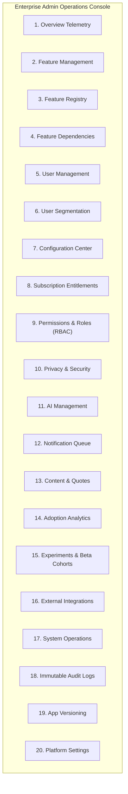

# SOULVERSE ADMIN SYSTEM & OPERATIONS AUDIT
**Audit Date:** 2026-11-13  
**Status:** Completed  
**Author:** Principal Software Architect & Security Systems Designer  

---

## 1. Executive Summary

The administration console of Soulverse ([AdminDashboard.tsx](file:///c:/Users/Work/Desktop/Friends_Dating/frontend/src/components/AdminDashboard.tsx)) manages platform health, user verification, trust & safety triage, discovery parameters, and feature rollout governance.

This audit evaluates current admin capabilities against enterprise reference architectures (**Refine.dev** and **Appsmith**) and establishes the implementation plan for the target **20-Destination Enterprise Admin Console**.

---

## 2. Current State vs Target 20-Destination Architecture



### Detailed Assessment of the 20 Admin Modules:

| Destination # | Administrative Domain | Current Implementation Status | Gap Analysis & Necessary Upgrades |
| :--- | :--- | :--- | :--- |
| **1. Overview** | Real-time platform vitals, active users, error rates | Partially Implemented (Cards present) | Connect to live SQLite queries rather than mock stats. |
| **2. Feature Management** | Global switchboard, rollout sliders (0–100%), kill-switches | **Implemented** in Control Layer | Full UI with live REST API persistence. |
| **3. Feature Registry** | Universal Feature Specification catalog & metadata | **Implemented** in Control Layer | Connected to `feature_registry` table. |
| **4. Feature Dependencies** | Dependency graph validation and circular check | Partially Implemented (pills displayed) | Add DAG graph visualizer and circular dependency validator. |
| **5. User Management** | Account search, verification badges, ban/suspend | **Implemented** | Working filters for verified, unverified, and suspensions. |
| **6. User Segmentation** | Cohorts, beta testers, regional tag targeting | Not Implemented | Add segment builder (`beta_cohort`, `power_users`, `new_members`). |
| **7. Configuration Center** | Remote config JSON payloads per feature | Partially Implemented | Expose `custom_config_json` editor for runtime tuning. |
| **8. Subscriptions** | Free, Plus, Sovereign tier gating | Partially Implemented (Schema ready) | Build entitlement matrix editor. |
| **9. Permissions & Roles** | Casbin-style RBAC (8 administrator roles) | Partially Implemented | Formalize role assignment UI and token middleware. |
| **10. Privacy & Security** | Safety reports queue, 1926 dispatch logs | **Implemented** | Working incident triage and 1926 hotline queue. |
| **11. AI Management** | Cognitive model controls, prompt tuning, token limits | Partially Implemented (Flag toggle) | Add rate limit adjustments and prompt template editor. |
| **12. Notifications** | Notification templates, quiet hours, push delivery | Not Implemented | Create push template manager and quiet hours monitor. |
| **13. Content Management** | Daily connection exercises, quotes, sanctuary texts | Partially Implemented | Add CRUD table for quotes and philosophical prompts. |
| **14. Adoption Analytics** | Feature activation vs abandonment bar charts | **Implemented** in Control Layer | Real-time counts from `feature_usage_events`. |
| **15. Experiments** | A/B testing cohorts and canary rollouts | Partially Implemented (Rollout %) | Add multi-variant strategy support. |
| **16. Integrations** | Spotify presets, OAuth client secrets, webhooks | **Implemented** for Spotify | Add webhook and external platform tester. |
| **17. System Operations** | SQLite WAL checkpoint, DB backup, cache flush | Partially Implemented (Snapshot JSON) | Add explicit VACUUM and WAL checkpoint triggers. |
| **18. Audit Logs** | Immutable before/after change trail with mandatory reasons | **Implemented** in Control Layer | Live query from `configuration_audit_logs`. |
| **19. Versioning** | Enforced minimum compatible client app version | Partially Implemented (Schema ready) | Expose minimum version update modal. |
| **20. Platform Settings**| Global broadcast announcement, maintenance banner | **Implemented** | Working global announcement toggle and text editor. |

---

## 3. Role-Based Access Control (RBAC) Specification

Administrative capabilities must be gated by 8 least-privilege roles:

```
Role                        Permitted Operations
─────────────────────────   ────────────────────────────────────────────────────────────────
Super Administrator         Full access to all 20 modules, database ops, and role assignment.
Product Administrator       Feature flags, rollouts, presets, and configuration center.
Technical Administrator     System operations, database checkpoints, performance, APIs.
Security Administrator      Emergency kill-switches, audit logs, and access policies.
Moderator                   Safety incidents queue, user reports, and account suspensions.
Support Administrator       User verification reviews and account assistance.
Content Administrator       Daily connection prompts, curated quotes, and Spotify presets.
Analyst                     Read-only access to aggregated telemetry and adoption charts.
```

---

## 4. Strict Sanctuary Privacy Guardrail

> [!CAUTION]
> **Architectural Law of Data Isolation:**  
> Under no circumstances may any administrator role—including `Super Administrator`—possess permissions or API endpoints to read or decrypt:
> 1. Private relationship notes stored in the Relationship Vault.
> 2. Personal journal entries stored in `profile_markdowns`.
> 3. Unsent words stored in `The Unspoken` sanctuary.
> 4. Unopened letters written by individual users.
> 5. Direct private chat messages without a formal legal/safety subpoena warrant.

Administrative tooling governs platform mechanisms, feature flags, infrastructure health, and trust triage. It never breaches user confidentiality sanctuaries.
