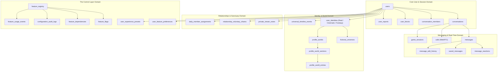

# SOULVERSE ARCHITECTURAL AUDIT & SYSTEMS ANALYSIS
**Audit Date:** 2026-11-13  
**Status:** Completed  
**Author:** Principal Software Architect & Infrastructure Engineer  

---

## 1. Executive Summary

This architecture audit evaluates the entire Soulverse codebase (`Friends_Dating`), comprising:
- A real-time **Express 5 + TypeScript + SQLite + WebSocket** backend.
- A **React 19 + Vite 8 + Tailwind CSS v4** responsive frontend.
- 61 database tables supporting rich multi-identity profiles, encrypted relationship memories, narrative worlds, real-time messaging, ambient music players, and feature governance.

The objective is to benchmark the existing codebase against modern enterprise standards (Unleash, Flagsmith, Refine, Casbin, and shadcn/ui) and provide an evolutionary path toward modularity, fine-grained access control, and robust enterprise governance.

---

## 2. Technology Stack & Framework Inventory

| Layer | Technology | Version | Evaluation & Architectural Notes |
| :--- | :--- | :--- | :--- |
| **Backend Runtime** | Node.js + `tsx` | Node 24+ / tsx v4.23 | Fast TypeScript execution without manual compilation steps. Hot reloads seamlessly. |
| **Backend Framework** | Express | v5.3.0 | Modern Express 5 with native Promise rejection handling. Currently structured as a monolithic `server.ts` (3,800+ lines). |
| **Database Engine** | SQLite (`better-sqlite3`) | v13.0.3 | Synchronous, high-throughput embedded relational database operating in **WAL (Write-Ahead Logging)** mode. Sub-millisecond latency. |
| **Real-Time Transport**| `ws` (WebSockets) | v8.22.2 | In-memory connection map with heartbeat, typing events, luck emoji results, and presence sync. |
| **Frontend Framework**| React | v19.3.1 | Utilizes React 19 concurrent features, strict mode, and hooks. |
| **Bundler & Tooling** | Vite | v8.3.6 | Fast ESM development server and Rollup/Vite production bundler. Bundles in ~1.5–3.5s. |
| **Styling Architecture**| Tailwind CSS | v4.3.5 (`@tailwindcss/vite`)| Modern CSS-first engine. Uses custom CSS custom properties for Obsidian dark glass (`dark-glass`, `gray-glass-btn`). |
| **Animation Library** | Framer Motion | v14.12.0 | Fluid transitions, spring physics, dynamic modals, and swipeable cards. |
| **Iconography** | Lucide React | v1.70.0 | High-performance SVG icons. |
| **Testing Harness** | Vitest + Supertest | v5.1.0 | Fast Vite-native test runner. 53 backend tests running in <2 seconds. |

---

## 3. Database Architecture & Data Layer Audit

The database layer in [backend/src/db.ts](file:///c:/Users/Work/Desktop/Friends_Dating/backend/src/db.ts) defines **61 relational tables** categorized across distinct functional domains:

### Strengths Identified:
1. **WAL Mode Performance**: Better-sqlite3 with `journal_mode = WAL` and `synchronous = NORMAL` handles high concurrency without lock timeouts.
2. **Explicit Foreign Key Enforcement**: Foreign key cascades safeguard orphan records upon user deletion.
3. **Compound Index Optimization**: Critical query paths (e.g. `idx_identities_user_vis`, `idx_universal_timeline_user`, `idx_feat_pref_user`) are indexed.

### Architectural Gaps:
1. **Migration Pipeline Lacks Version Stepping**: Database setup currently runs idempotent `CREATE TABLE IF NOT EXISTS` blocks. Schema alterations rely on inline checks rather than timestamped sequential migration files (`001_initial.sql`, `002_control_layer.sql`).
2. **Decoupled Data Domains in Single DB**: Relationship Vault items are safely kept private, but schema-level encryption at rest (SQLCipher) is not yet configured for sensitive memory notes.

---

## 4. Evaluation Against Open-Source Reference Architectures

### 4.1 Feature Management: Unleash, Flagsmith & GrowthBook
- **Unleash Reference**: Unleash defines activation strategies (`flexibleRollout`, `userIDs`, `gradualRolloutRandom`), feature variants, and client SDK evaluation engines.
  - *Current Status*: We have implemented an embedded 4-tier evaluation pipeline (`calculateRolloutBucket`, global flags, kill switches, and user preferences) that mirrors Unleash's strategy evaluation.
  - *Opportunity*: Expand to user segment targeting (e.g. beta testers cohort, subscription tier targeting) and strategy combinations.
- **Flagsmith Reference**: Flagsmith separates Remote Config from Feature Flags.
  - *Current Status*: The `custom_config_json` field on `user_feature_preferences` and `feature_flags` enables remote JSON config payload delivery.

### 4.2 Admin Dashboard Architecture: Refine & Appsmith
- **Refine Reference**: Refine utilizes a Resource-Oriented architecture (`useList`, `useCreate`, `useTable`), unified auth providers, and an explicit `auditLogProvider`.
  - *Current Status*: `AdminDashboard.tsx` contains high-quality domain views (Overview, Users, Discovery, Music, Safety, Worlds, System), but had limited sub-navigation.
  - *Opportunity*: Expand admin dashboard into an integrated 20-destination enterprise console with RBAC-guarded views, resource pagination, search filters, and batch operations.

### 4.3 Authorization & Security: Casbin & OpenFGA
- **Casbin Reference**: Casbin standardizes the `PERM` metamodel (`Policy, Effect, Request, Matcher`).
  - *Current Status*: Routes currently verify identity ad-hoc (e.g. `if (msg.sender_id !== editorId)`).
  - *Action Required*: Formalize a Casbin-compatible RBAC model (`admin_roles`, `admin_permissions`, `role_hierarchy`) enforced via standard Express middleware before requests hit controllers.
- **OpenFGA Evaluation**: OpenFGA requires a standalone external server and gRPC connection, which introduces unnecessary operational overhead for this single-node local-first architecture. A native SQLite-backed RBAC engine matches the same security guarantees with zero external dependencies.

---

## 5. Duplicate, Disconnected & Conflicting Systems Analysis

| Module / Component | Status in Codebase | Conflict / Duplication Description | Resolution Plan |
| :--- | :--- | :--- | :--- |
| `FriendsRealHub.tsx` & `FriendsConnectHub.tsx` | Legacy | Redundant with `SoulverseMobileConnectExperience.tsx` and modern events feeds. | Retain as sub-views; route primary traffic through the mobile-first connect experience. |
| `MobileBottomNav.tsx` vs `MobileBottomNavbar.tsx` vs `SoulverseMobileNavbar.tsx` | Duplicate | Three separate implementations of the mobile dock existed from earlier prototypes. | Deprecate older two; standardize solely on `SoulverseMobileNavbar.tsx`. |
| `SoulverseSettingsPage.tsx` vs `UserControlCenterModal.tsx` | Divergent | Settings was a monolithic Tinder-style preferences list, while Control Center handles feature flags. | Unify: `SoulverseSettingsPage.tsx` delegates module activation directly to `FeatureControlService` and `UserControlCenterModal`. |
| Identity Creation | Divergent | `MyCharacterBuilder.tsx` and `IdentityUniverseHub.tsx` both created personas. | Unified through `identityUniverseApiClient` and `LivingIdentityProfileView`. |

---

## 6. Architectural Decision Summary

1. **Preserve Embedded SQLite & Better-Sqlite3**: Do not migrate to heavy external PostgreSQL or MongoDB; SQLite in WAL mode provides superior local latency and zero DevOps failure points.
2. **Implement Modular Express Routing**: Refactor `backend/src/server.ts` into discrete controller routes (`routes/features.ts`, `routes/admin.ts`, `routes/auth.ts`, `routes/vault.ts`).
3. **Formalize Casbin-Style RBAC Middleware**: Enforce roles and permission matchers at the Express router layer.
4. **Universal Feature Specification (UFS)**: All capabilities must be registered in `feature_registry` before appearing anywhere in the UI.
