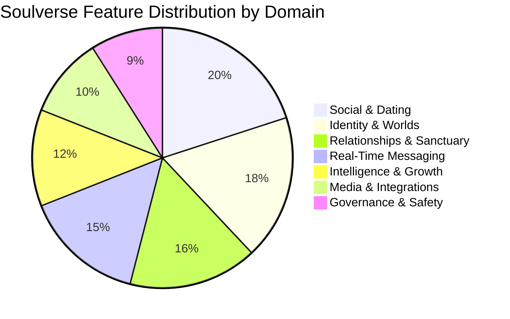

# SOULVERSE EXISTING FEATURE INVENTORY & FUNCTIONAL REGISTRY
**Audit Date:** 2026-11-13  
**Status:** Completed  
**Author:** Principal Software Architect & Product Infrastructure Engineer  

---

## 1. Feature Registry & Domain Catalog

Every capability within the Soulverse application has been catalogued under the Universal Feature Specification (UFS). This inventory serves as the single source of truth for feature flags, dependencies, and access control.

---

## 2. Exhaustive Feature Matrix

| ID | Feature Name | Domain / Category | Default State | Privacy Classification | Primary Source Files | Functional Description |
| :--- | :--- | :--- | :--- | :--- | :--- | :--- |
| **`feat_dating`** | Dating & Chemistry | `social` | Available | Selective | [SoulverseDiscoverPage.tsx](file:///c:/Users/Work/Desktop/Friends_Dating/frontend/src/components/SoulverseDiscoverPage.tsx) [SwipeDiscoveryView.tsx](file:///c:/Users/Work/Desktop/Friends_Dating/frontend/src/components/SwipeDiscoveryView.tsx) | Romantic card stack swiping, ontological matching score (HCM 0–100%), verified badges, and mutual attraction matching. |
| **`feat_friendships`** | Friendships & Circles | `social` | Enabled | Public | [SoulverseMobileDiscoverExperience.tsx](file:///c:/Users/Work/Desktop/Friends_Dating/frontend/src/components/mobile/SoulverseMobileDiscoverExperience.tsx) [CommunitiesHub.tsx](file:///c:/Users/Work/Desktop/Friends_Dating/frontend/src/components/CommunitiesHub.tsx) | Platonic connection feeds, shared passion filters (`#DeepTalk`, `#Books`, `#Music`, `#Hiking`), and friendship request flows. |
| **`feat_relationship_vault`**| Relationship Vault & Memories | `relationships` | Available | Private Encrypted | [RelationshipVaultDashboard.tsx](file:///c:/Users/Work/Desktop/Friends_Dating/frontend/src/components/vault/RelationshipVaultDashboard.tsx) [BeforeYouTalkSheet.tsx](file:///c:/Users/Work/Desktop/Friends_Dating/frontend/src/components/vault/BeforeYouTalkSheet.tsx) | Private relationship CRM: important dates, boundary preferences, promises, emotional history, and Before-You-Talk instant briefings. Zero admin access. |
| **`feat_personal_journal`** | 5,000-Char Markdown Journal | `growth` | Available | Selective | [GitHubMarkdownEditor.tsx](file:///c:/Users/Work/Desktop/Friends_Dating/frontend/src/components/GitHubMarkdownEditor.tsx) [GitHubMarkdownRenderer.tsx](file:///c:/Users/Work/Desktop/Friends_Dating/frontend/src/components/GitHubMarkdownRenderer.tsx) | GitHub Flavored Markdown editor with live tabbed preview, character counter (0–5,000), code syntax, and personal diary storage. |
| **`feat_imaginary_identities`**| Identity Universe & Personas | `identity` | Available | Selective | [IdentityUniverseHub.tsx](file:///c:/Users/Work/Desktop/Friends_Dating/frontend/src/components/IdentityUniverseHub.tsx) [LivingIdentityProfileView.tsx](file:///c:/Users/Work/Desktop/Friends_Dating/frontend/src/components/LivingIdentityProfileView.tsx) | Multi-persona creation: Real Me, Professional Me, Cinematic Persona, and creative alter-egos with isolated contact graphs and permissions. |
| **`feat_cinematic_profiles`**| Cinematic Narrative Worlds | `identity` | Available | Public | [ProfileWorldsHub.tsx](file:///c:/Users/Work/Desktop/Friends_Dating/frontend/src/components/ProfileWorldsHub.tsx) [MyWorldProfile.tsx](file:///c:/Users/Work/Desktop/Friends_Dating/frontend/src/components/MyWorldProfile.tsx) | Living digital worlds with custom atmospheric audio, episodic narrative chapters, visual aesthetics, and visitor guestbooks. |
| **`feat_group_relationships`**| Polycules & Chosen Family Circles | `relationships` | Available | Selective | [SoulverseConnectionsPage.tsx](file:///c:/Users/Work/Desktop/Friends_Dating/frontend/src/components/SoulverseConnectionsPage.tsx) | Non-traditional relationship support: polycule maps, chosen family pods, shared milestone calendars, and relational agreements. |
| **`feat_ai_assistant`** | Soulverse Cognitive Assistant | `intelligence` | Disabled | Strictly Local | [server.ts](file:///c:/Users/Work/Desktop/Friends_Dating/backend/src/server.ts) | Privacy-first on-demand conversational intelligence, empathy coaching, and psychological matching insights. Strictly zero server training. |
| **`feat_daily_quotes`** | Daily Philosophy & Quotes | `growth` | Enabled | Public | [DailyConnectionHub.tsx](file:///c:/Users/Work/Desktop/Friends_Dating/frontend/src/components/DailyConnectionHub.tsx) | Morning contemplative prompts, philosophical quotes, existential reflection cards, and daily mindful connection thoughts. |
| **`feat_personality_exploration`**| Personality & Value Discovery | `growth` | Available | Selective | [SelfDiscoveryHub.tsx](file:///c:/Users/Work/Desktop/Friends_Dating/frontend/src/components/SelfDiscoveryHub.tsx) [EditProfileInfoModal.tsx](file:///c:/Users/Work/Desktop/Friends_Dating/frontend/src/components/EditProfileInfoModal.tsx) | Psychological values assessment, attachment style profiling, Big Five dimensions, and communication preference indicators. |
| **`feat_events_parties`** | Events & Watch Parties | `social` | Available | Public | [EventsHub.tsx](file:///c:/Users/Work/Desktop/Friends_Dating/frontend/src/components/EventsHub.tsx) [SoulverseMobileConnectExperience.tsx](file:///c:/Users/Work/Desktop/Friends_Dating/frontend/src/components/mobile/SoulverseMobileConnectExperience.tsx) | In-person gathering directories, virtual listening rooms, RSVP tracking, and community calendar sync. |
| **`feat_external_connections`**| External Social Connections | `social` | Available | Selective | [backend/src/social-platforms/registry.ts](file:///c:/Users/Work/Desktop/Friends_Dating/backend/src/social-platforms/registry.ts) [SoulverseSettingsPage.tsx](file:///c:/Users/Work/Desktop/Friends_Dating/frontend/src/components/SoulverseSettingsPage.tsx) | Verified external social platform links (Spotify, Instagram, GitHub, Telegram, Discord) with safe URL parsing and validation. |
| **`feat_the_unspoken`** | The Unspoken Sanctuary | `growth` | Enabled | Strictly Local | [TheUnspokenSanctuary.tsx](file:///c:/Users/Work/Desktop/Friends_Dating/frontend/src/components/emotional/TheUnspokenSanctuary.tsx) [emotionalContentEngine.ts](file:///c:/Users/Work/Desktop/Friends_Dating/frontend/src/services/emotionalContentEngine.ts) | Tranquil emotional sanctuary: Inner Room mood selector, Midnight Thoughts collection, Unopened Letters, and private Unsent Words notebook. |
| **`feat_spotify_ambient`** | Spotify Music Integration | `media` | Enabled | Selective | [SpotifyPlayerWidget.tsx](file:///c:/Users/Work/Desktop/Friends_Dating/frontend/src/components/SpotifyPlayerWidget.tsx) [SpotifyMusicContext.tsx](file:///c:/Users/Work/Desktop/Friends_Dating/frontend/src/context/SpotifyMusicContext.tsx) | Titanium glass mini-dock audio player, profile soundtrack anthem binding, ambient playlist presets, and synchronized playback. |
| **`feat_two_person_questions`**| One Question, Two People | `relationships` | Enabled | Selective | [TwoPersonQuestionModal.tsx](file:///c:/Users/Work/Desktop/Friends_Dating/frontend/src/components/emotional/TwoPersonQuestionModal.tsx) [MessagingInboxView.tsx](file:///c:/Users/Work/Desktop/Friends_Dating/frontend/src/components/MessagingInboxView.tsx) | Synchronous lock-and-reveal question game in chat headers: responses remain frosted and locked until both parties privately submit. |
| **`feat_timeline_view`** | Year-by-Year Life Timeline | `identity` | Available | Selective | [YearLifeTimelineView.tsx](file:///c:/Users/Work/Desktop/Friends_Dating/frontend/src/components/YearLifeTimelineView.tsx) | Chronological life narrative: birth era, formative years, breakthroughs, crisis chapters, and defining milestone markers. |

---

## 3. Subsystem Deep-Dive: Real-Time Messaging & Rooms

The messaging engine in [MessagingInboxView.tsx](file:///c:/Users/Work/Desktop/Friends_Dating/frontend/src/components/MessagingInboxView.tsx) represents an extensive Telegram Desktop / Web inspired subsystem:

- **Message Lifecycle**: Send, live delivered/read checkmarks, edit message with edit history audit, pin message, reply thread, bookmark/save, quote forward.
- **Rich Media**: Voice notes with audio waveform recording and playback ([VoiceWaveformPlayer.tsx](file:///c:/Users/Work/Desktop/Friends_Dating/frontend/src/components/VoiceWaveformPlayer.tsx)), photo attachments with fullscreen preview, WebRTC encrypted voice and video calling.
- **Luck Emoji Sandboxed Games**: 🎲 Dice duel, 🎰 Slot machine jackpot, 🪙 Coin flip with server-authoritative seed generation ([TelegramLuckEmoji.tsx](file:///c:/Users/Work/Desktop/Friends_Dating/frontend/src/components/TelegramLuckEmoji.tsx)).
- **Relational Briefing Pill**: "Before You Talk" button directly in the chat header providing instant emotional safety briefings from the Relationship Vault.

---

## 4. Subsystem Deep-Dive: Safety, Mental Health & 1926 Hotline

Soulverse integrates a dedicated mental health and safety framework:
- **1926 Safe NIMH Hotline**: Dedicated mental health crisis dispatch modal ([CrisisSupportModal.tsx](file:///c:/Users/Work/Desktop/Friends_Dating/frontend/src/components/CrisisSupportModal.tsx)) accessible from header buttons and crisis triggers.
- **Contact Blocking & Reporting**: Real-time exclusion from discovery feeds with report classification triage.
- **Privacy Controls**: Tinder-style distance sliders, age filters, verified-only toggles, and incognito browsing tiers.
