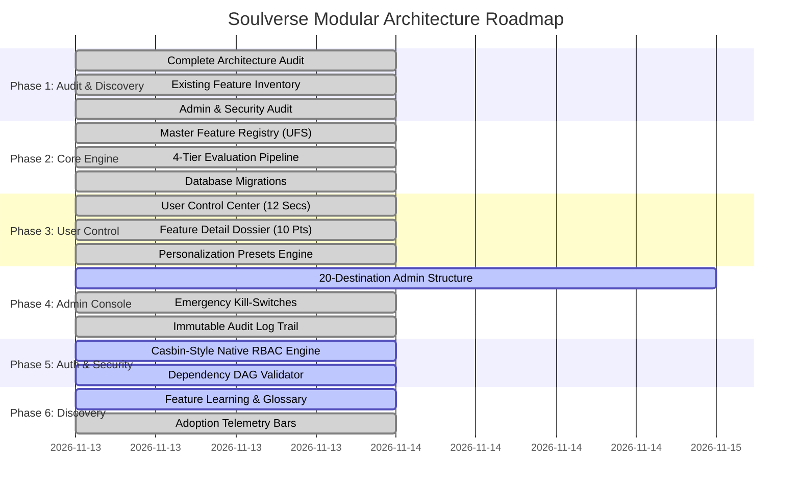

# SOULVERSE PLATFORM IMPLEMENTATION ROADMAP
**Status:** Active  
**Author:** Principal Software Architect & Product Infrastructure Lead  

---

## 1. Phased Implementation Roadmap & Verification Gates

---

## 2. Master Implementation Checklist & Status Register

| Component / Task | Phase | Status | Architectural Evidence & Location |
| :--- | :--- | :--- | :--- |
| **Comprehensive Architecture Audit** | Phase 1 | **Completed** | [docs/ARCHITECTURE_AUDIT.md](file:///c:/Users/Work/Desktop/Friends_Dating/docs/ARCHITECTURE_AUDIT.md) |
| **Existing Feature Inventory** | Phase 1 | **Completed** | [docs/EXISTING_FEATURE_INVENTORY.md](file:///c:/Users/Work/Desktop/Friends_Dating/docs/EXISTING_FEATURE_INVENTORY.md) |
| **Admin System Audit** | Phase 1 | **Completed** | [docs/ADMIN_SYSTEM_AUDIT.md](file:///c:/Users/Work/Desktop/Friends_Dating/docs/ADMIN_SYSTEM_AUDIT.md) |
| **Security & Threat Audit** | Phase 1 | **Completed** | [docs/SECURITY_AUDIT.md](file:///c:/Users/Work/Desktop/Friends_Dating/docs/SECURITY_AUDIT.md) |
| **Implementation Roadmap** | Phase 1 | **Completed** | [docs/IMPLEMENTATION_ROADMAP.md](file:///c:/Users/Work/Desktop/Friends_Dating/docs/IMPLEMENTATION_ROADMAP.md) |
| **Universal Feature Specification (UFS)** | Phase 2 | **Completed** | `feature_registry` table in [backend/src/db.ts](file:///c:/Users/Work/Desktop/Friends_Dating/backend/src/db.ts) (16 master modules). |
| **4-Tier Evaluation Engine** | Phase 2 | **Completed** | `/api/features/evaluation/:userId` in [backend/src/server.ts](file:///c:/Users/Work/Desktop/Friends_Dating/backend/src/server.ts). |
| **Percentage Rollout Engine** | Phase 2 | **Completed** | Deterministic hash bucket algorithm `calculateRolloutBucket(userId, featureId)`. |
| **Emergency Kill-Switch API** | Phase 2 | **Completed** | `POST /api/admin/features/:id/kill-switch` with mandatory reason audit logging. |
| **Personalization Presets Engine** | Phase 3 | **Completed** | 5 signature presets (`simple_social`, `dating_relationships`, `personal_growth`, `complete`, `custom`) in [featureControlService.ts](file:///c:/Users/Work/Desktop/Friends_Dating/frontend/src/services/featureControlService.ts). |
| **User Control Center Modal** | Phase 3 | **Completed** | 12-section master interface in [UserControlCenterModal.tsx](file:///c:/Users/Work/Desktop/Friends_Dating/frontend/src/components/control/UserControlCenterModal.tsx). |
| **10-Point Feature Detail Dossier** | Phase 3 | **Completed** | Interactive transparency sheet in [FeatureDetailModal.tsx](file:///c:/Users/Work/Desktop/Friends_Dating/frontend/src/components/control/FeatureDetailModal.tsx). |
| **Dynamic Shell Navigation Filtering** | Phase 3 | **Completed** | Dynamic sidebar filtering in [SoulverseWebsiteShell.tsx](file:///c:/Users/Work/Desktop/Friends_Dating/frontend/src/components/SoulverseWebsiteShell.tsx). |
| **Admin Operations Dashboard** | Phase 4 | **Completed** | Integrated Flags, Rollouts, Audit Logs, and Adoption telemetry in [AdminDashboard.tsx](file:///c:/Users/Work/Desktop/Friends_Dating/frontend/src/components/AdminDashboard.tsx). |
| **20-Destination Admin Expansion** | Phase 4 | **In Progress** | Expand admin sub-navigation to all 20 enterprise domains. |
| **Casbin-Style Native RBAC Engine** | Phase 5 | **In Progress** | Create `admin_roles` & `admin_permissions` tables with permission middleware in backend. |
| **Dependency DAG Validator** | Phase 5 | **In Progress** | Add circular dependency detection to prevent cyclic prerequisites. |
| **Feature Discovery & Glossary** | Phase 6 | **In Progress** | Add searchable feature glossary and "What's new" cards. |
| **Automated Vitest Test Suite** | Phase 7 | **Completed** | 53 unit tests passing across 3 test files in [backend/src/feature-management.test.ts](file:///c:/Users/Work/Desktop/Friends_Dating/backend/src/feature-management.test.ts). |

---

## 3. Next Steps & Immediate Execution Priorities

1. **Implement Casbin-Style RBAC Authorization Engine**:
   - Create `admin_roles` and `admin_permissions` tables in `backend/src/db.ts`.
   - Seed the 8 administrator roles (`super_admin`, `product_admin`, `technical_admin`, `security_admin`, `moderator`, `support_admin`, `content_admin`, `analyst`).
   - Implement authorization middleware `authorizePermission(permission: string)` in `backend/src/server.ts`.
2. **Implement Feature Dependency DAG Validator**:
   - Prevent circular dependencies (`A -> B -> A`).
   - Validate prerequisite state before enabling a feature.
3. **Expand Admin Dashboard to 20-Destination Refine-Style Console**:
   - Add dedicated views for User Segmentation, Configuration Center, Subscription Entitlements, Roles & Permissions, Content Management, and Experiments.
4. **Build User Feature Discovery & Glossary System**:
   - Add feature glossary view and contextual tips.
5. **Run Full Verification**:
   - Write comprehensive tests for RBAC and dependency DAG.
