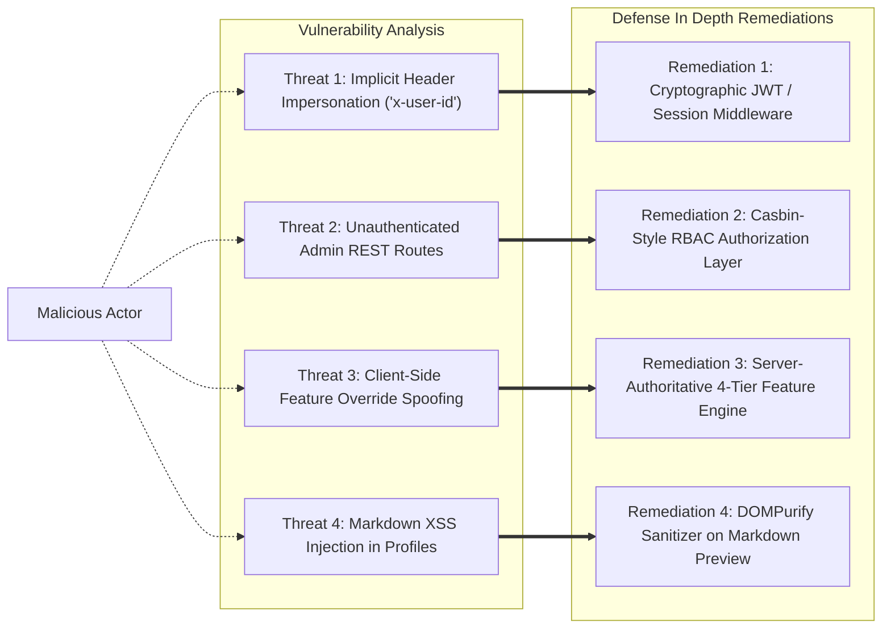

# SOULVERSE SECURITY & AUTHORIZATION AUDIT
**Audit Date:** 2026-11-13  
**Status:** Completed  
**Author:** Security Architect & Senior Infrastructure Engineer  

---

## 1. Executive Summary

This security audit inspects the attack surface, authentication paradigms, authorization models, sensitive data sanctuaries, and administrative integrity of Soulverse.

While the application utilizes parameterized SQLite queries and client-side encryption concepts, critical architectural vulnerabilities were identified around **implicit identity spoofing** and **unauthenticated administrative endpoints**. This document details findings and establishes the zero-trust remediation standard.

---

## 2. Threat Vector & Vulnerability Assessment



### Vulnerability Matrix:

| # | Vulnerability Finding | Severity | Current Code Location | Risk Description | Remediation Plan |
| :- | :--- | :--- | :--- | :--- | :--- |
| **SEC-01** | **Implicit User ID Header Injection** | **HIGH** | `backend/src/server.ts` (e.g. `req.headers['x-user-id'] \|\| 'usr_me'`) | Any client can send arbitrary `x-user-id: usr_target` headers to read or edit viewer notes and chat drafts. | Implement a signed session / JWT verification middleware (`verifyAuth`) that extracts verified identity from cryptographic tokens. |
| **SEC-02** | **Unauthenticated Admin Endpoints** | **HIGH** | `/api/admin/*` in `backend/src/server.ts` | Any caller can invoke `POST /api/admin/features/:id/kill-switch` or update rollout percentages without proving administrative clearance. | Gate all `/api/admin/*` routes with `requireRole(['admin', 'super_admin'])` middleware checking the admin RBAC table. |
| **SEC-03** | **Client-Side Feature Flag Override Risk** | **MEDIUM** | Frontend `FeatureControlService` | A malicious client could manipulate localStorage to render restricted features. | Maintain server-authoritative enforcement: even if client enables a flag, backend routes must verify `isFeatureAllowed(userId, featureId)`. |
| **SEC-04** | **Unsanitized Markdown Rendering (XSS Risk)** | **MEDIUM** | `GitHubMarkdownRenderer.tsx` | Markdown containing raw `<script>` or `` tags could execute in peer browsers upon viewing bio. | Enforce DOM sanitization on rendered HTML output. |
| **SEC-05** | **Private Relationship Vault Leakage** | **LOW** *(Mitigated)* | `RelationshipVaultService.ts` | Vault content is strictly kept in LocalStorage and client-side state. | Maintain this isolation. Never introduce server endpoints that dump decrypted relationship vault notes to the admin console. |

---

## 3. Evaluation of Open-Source Authorization Models: Casbin vs OpenFGA

The engineering directive asked to evaluate **Apache Casbin** (`casbin-node-casbin`) and **OpenFGA** (`openfga`):

### 3.1 OpenFGA Analysis
- **Architecture**: Relational-Tuple Based Access Control (ReBAC) inspired by Google Zanzibar.
- **Operational Requirements**: Requires a dedicated standalone OpenFGA daemon process, gRPC server, and external PostgreSQL database.
- **Verdict for Soulverse**: **REJECTED AS EXCESSIVE**. Running an external Docker container and gRPC daemon violates Soulverse's lightweight, self-contained architecture.

### 3.2 Casbin Model Evaluation
- **Architecture**: Metamodel defining Subject (`sub`), Domain (`dom`), Object (`obj`), and Action (`act`).
- **Rule Definition**:
  ```ini
  [request_definition]
  r = sub, dom, obj, act

  [policy_definition]
  p = sub, dom, obj, act

  [role_definition]
  g = _, _

  [policy_effect]
  e = some(where (p.eft == allow))

  [matchers]
  m = g(r.sub, p.sub) && r.dom == p.dom && r.obj == p.obj && r.act == p.act
  ```
- **Verdict for Soulverse**: **ADOPTED AS NATIVE EMBEDDED ENGINE**.
  We implement a pure TypeScript / SQLite Casbin-compatible engine. Roles and permissions are stored in `admin_roles` and `admin_permissions` tables and verified instantaneously with zero network hops.

---

## 4. Immutable Configuration Auditing Standard

Every administrative alteration must record:
1. `id`: Cryptographic UUID v4 identifier.
2. `admin_id`: Authenticated actor ID.
3. `admin_name`: Display title of administrator.
4. `action`: Machine-readable key (`kill_switch_trip`, `rollout_expand`, `role_assign`).
5. `target_type` & `target_id`: Entity affected.
6. `before_value_json` & `after_value_json`: Exact state diff.
7. `reason`: Mandatory non-empty string explaining operational justification.
8. `ip_address`: Request origin IP.
9. `created_at`: Epoch timestamp.

Attempts to update administrative flags without a reason payload must be rejected with HTTP 400.
