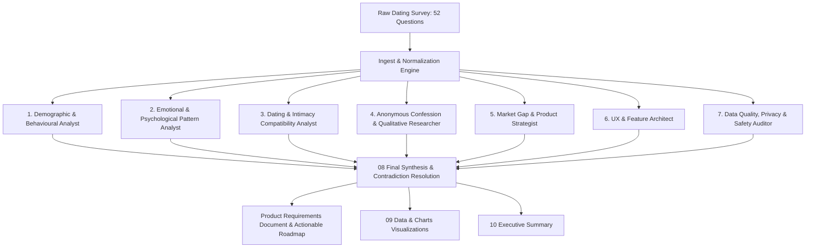

# OVERNIGHT OPERATION: DATING HUMAN INTELLIGENCE
## Operational Briefing & Pipeline Architecture

**Role:** Chief Research Director & Product Intelligence Architect  
**Platform:** Soulverse / Next-Generation Social & Relationship Platform  
**Status:** Pipeline Architecture Ready • Awaiting Survey Dataset Payload  

---

## 1. Research Operations Matrix

The 7 independent research task modules are structured as follows:



---

## 2. Directory Deliverables Layout

```
/research
  /01-demographics
     └── demographics_analysis.md (Age, gender, location, dating frequency, denominators)
  /02-behaviour
     └── behavioral_patterns.md (Ghosting, communication cadences, app fatigue, texting habits)
  /03-psychology
     └── emotional_archetypes.md (Needs, fears, attachment signals, stated vs revealed contradictions)
  /04-compatibility
     └── compatibility_vectors.md (Dealbreakers, values, lifestyle sync, chemistry drivers)
  /05-confessions
     └── qualitative_verbatim_study.md (Direct quotes, Sinhala-English expressions, unmet cries)
  /06-product-opportunities
     └── feature_opportunity_matrix.md (Impact vs difficulty scoring, market gap analysis)
  /07-safety-audit
     └── privacy_consent_audit.md (Harassment vulnerabilities, verification, boundary enforcement)
  /08-final-synthesis
     ├── BLOCKER_AUDIT.md (Dataset discovery audit)
     └── master_synthesis_report.md (Contradiction resolution, evidence validation, prioritized roadmap)
  /09-data-and-charts
     ├── statistical_breakdown.json
     └── survey_distributions_chart.html
  /10-executive-summary
     ├── RESEARCH_DIRECTOR_BRIEF.md
     └── master_executive_report.md
```

---

## 3. Immediate Action Required

As soon as the 52-question survey dataset is supplied (via direct chat paste or placed at `research/raw_data/survey.csv`), the operation will run to full completion without simulated answers or hallucinations.
